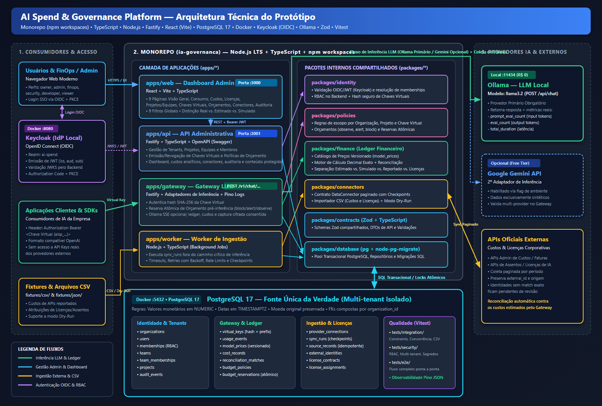

# AI Spend & Governance Platform — Visão Geral, Arquitetura e Índice do Escopo

- **Versão:** 1.0
- **Objetivo:** Provar o conceito de uma plataforma unificada de governança, consumo e custos de inteligência artificial.
- **Ambiente:** Desenvolvimento local
- **Orçamento-alvo:** R$ 0 em serviços pagos durante o desenvolvimento
- **Stack Principal:** TypeScript, Node.js, Fastify, React (Vite), PostgreSQL, Docker, Keycloak, Ollama, Zod, Vitest, OpenAPI.

---

## 1. Visão Geral do Projeto

### 1.1. Objetivo
Construir um protótipo funcional capaz de demonstrar como uma empresa pode centralizar a governança financeira e operacional de ferramentas de inteligência artificial.

O sistema consolida informações de:
- Consumo de APIs de LLM.
- Custos estimados e custos reportados pelos fornecedores.
- Licenças corporativas, assentos atribuídos e indicadores de utilização.
- Usuários, equipes, projetos e permissões.
- Políticas de orçamento e limites de consumo.
- Histórico de chamadas e auditoria.
- Diferentes provedores de IA por meio de um gateway centralizado.

A plataforma deve mostrar, em um único dashboard, quanto foi consumido, qual foi o custo, qual é a origem dos dados e onde existem divergências.

### 1.2. Estratégia de Desenvolvimento
O projeto é desenvolvido inicialmente como um laboratório local, sem necessidade de infraestrutura de nuvem, banco gerenciado, serviço de autenticação pago ou APIs comerciais para concluir a primeira versão.

Tipos de dados utilizados:
1. **Dados sintéticos** para validar o produto.
2. **Chamadas a uma LLM executada localmente (Ollama)** para testar o gateway.
3. **Dados reais de APIs oficiais**, quando houver acesso gratuito ou conta autorizada disponível.

> [!IMPORTANT]
> A arquitetura deve permitir substituir os componentes de demonstração por integrações reais sem reescrever o domínio financeiro.

### 1.3. Fora de Escopo (Versão 1.0)
- Marketplace de agentes e skills.
- Análise de dependências entre agentes e skills.
- Faturamento de clientes.
- Previsão financeira baseada em machine learning.
- Roteamento inteligente de modelos por qualidade e custo.
- Implantação multi-região.
- Alta disponibilidade de produção.

---

## 2. Arquitetura e Organização do Monorepo

### 2.0. Diagrama Técnico da Arquitetura
Os desenhos técnicos da arquitetura com todas as tecnologias e conexões estão disponíveis em:
- Imagem Raster (PNG/JPG): [arquitetura-tecnica.png](../desenhos/arquitetura-tecnica.png) | [arquitetura-tecnica.jpg](../desenhos/arquitetura-tecnica.jpg)
- Diagrama Vetorial Escalável (SVG): [arquitetura-tecnica.svg](../desenhos/arquitetura-tecnica.svg)



### 2.1. Componentes do Sistema
- **Frontend (`apps/web`):** Dashboard administrativo.
- **API Administrativa (`apps/api`):** Gestão de organizações, usuários, projetos e conectores.
- **Gateway LLM (`apps/gateway`):** Recebe chamadas das aplicações, autentica chaves virtuais e encaminha aos provedores.
- **Workers (`apps/worker`):** Executam sincronizações e importações fora do caminho crítico das chamadas de inferência.
- **Serviço de Políticas (`packages/policies`):** Valida permissões, limites e orçamentos.
- **Ledger Financeiro (`packages/finance`):** Registra eventos de uso, preços, custos e reconciliação.
- **Framework de Conectores (`packages/connectors`):** Coleta dados por APIs e CSV.
- **Identidade (`packages/identity`):** Autenticação OIDC e autorização RBAC.
- **Banco de Dados (`packages/database`):** Acesso ao PostgreSQL e migrações.
- **Contratos (`packages/contracts`):** Contratos TypeScript e validações Zod compartilhadas.
- **Infraestrutura Local:** PostgreSQL (fonte de verdade), Keycloak (SSO/OIDC local), Ollama (inferência LLM local).

### 2.2. Estrutura de Diretórios
```text
ia-governanca/
├── apps/
│   ├── api/
│   │   └── src/
│   ├── gateway/
│   │   └── src/
│   ├── worker/
│   │   └── src/
│   └── web/
│       └── src/
├── packages/
│   ├── contracts/
│   ├── database/
│   ├── connectors/
│   ├── identity/
│   ├── policies/
│   └── finance/
├── migrations/
├── fixtures/
│   ├── csv/
│   └── json/
├── tests/
│   ├── integration/
│   ├── security/
│   └── e2e/
├── docker-compose.yml
├── .env.example
├── .gitignore
├── package.json
└── README.md
```

---

## 3. Plano de Execução Faseado e Mapa de Épicos

> [!WARNING]
> **Regras de Bloqueio de Fase:**
> 1. Não avançar para o **Gateway (Épico 05)** antes de validar a **LLM local no Ollama (Épico 00)**.
> 2. Não avançar para o **Dashboard (Épico 08)** antes de validar o **registro de uma chamada real no ledger (Épico 05 e 06)**.
> 3. Não avançar para a **Integração Financeira Externa (Épico 07)** antes de validar os **cálculos com dados sintéticos (Épico 06)**.

| Ordem | Entrega | Resultado Esperado | Épico Correspondente |
| :---: | :--- | :--- | :--- |
| **0** | Pré-requisitos e LLM local | Ferramentas instaladas e Ollama respondendo via API | **Épico 00** |
| **1** | Ambiente local e Repositório | Monorepo, contratos, TypeScript e PostgreSQL funcionando | **Épico 01** |
| **2** | Banco e domínio | Entidades, migrações e constraints multi-tenant | **Épico 02** |
| **3** | Identidade | Login OIDC (Keycloak) e isolamento multi-tenant RBAC | **Épico 03** |
| **4** | Framework de conectores | Contratos, worker e importador CSV com idempotência | **Épico 04** |
| **5** | Gateway local | Chamadas reais à LLM local autenticadas e registradas | **Épico 05** |
| **6** | Ledger financeiro e Orçamentos | Custos calculados com precisão e políticas aplicadas | **Épico 06** |
| **7** | Integrações externas | Conectores externos de custos, licenças e 2º provedor | **Épico 07** |
| **8** | Dashboard | Visão consolidada, indicadores e filtros | **Épico 08** |
| **9** | Testes, Segurança e Hardening | Observabilidade, resiliência e fluxo E2E validado | **Épico 09** |
| **10** | Melhorias iniciais | Governança, transparência de inferência e evolução da experiência/custos | **Épico 10** |
| **11** | Compatibilidade com clientes agentes | Gateway governando chamadas de ferramentas e do Copilot CLI via BYOK | **Épico 11** |

---

## 4. Índice Detalhado de Tarefas por Épico

### Épico 00 — Pré-requisitos e Validação da LLM Local
- [Tarefa 0.1 — Instalação e Validação dos Softwares Base](./epico-00-pre-requisitos/tarefa-0.1-instalacao-softwares-base.md)
- [Tarefa 0.2 — Instalação e Validação da LLM Local (Ollama)](./epico-00-pre-requisitos/tarefa-0.2-validacao-llm-local-ollama.md)

### Épico 01 — Preparar o Ambiente e Monorepo
- [Tarefa 1.1 — Criar o Repositório e Estrutura de Monorepo](./epico-01-preparacao-ambiente/tarefa-1.1-criar-repositorio-monorepo.md)
- [Tarefa 1.2 — Configurar as Dependências Base](./epico-01-preparacao-ambiente/tarefa-1.2-configurar-dependencias.md)
- [Tarefa 1.3 — Preparar Variáveis de Ambiente](./epico-01-preparacao-ambiente/tarefa-1.3-preparar-variaveis-ambiente.md)
- [Tarefa 1.4 — Subir e Validar o Banco de Dados PostgreSQL](./epico-01-preparacao-ambiente/tarefa-1.4-subir-banco-dados-postgresql.md)

### Épico 02 — Implementar o Domínio e o Banco de Dados
- [Tarefa 2.1 — Migração: Organizações e Identidade](./epico-02-dominio-e-banco-de-dados/tarefa-2.1-organizacoes-e-identidade.md)
- [Tarefa 2.2 — Migração: Conectores e Ingestão](./epico-02-dominio-e-banco-de-dados/tarefa-2.2-conectores-e-ingestao.md)
- [Tarefa 2.3 — Migração: Licenças e Assentos](./epico-02-dominio-e-banco-de-dados/tarefa-2.3-licencas.md)
- [Tarefa 2.4 — Migração: Gateway, Ledger Financeiro e Orçamentos](./epico-02-dominio-e-banco-de-dados/tarefa-2.4-gateway-e-financas.md)
- [Tarefa 2.5 — Testes de Integridade do Domínio e Isolamento](./epico-02-dominio-e-banco-de-dados/tarefa-2.5-testar-integridade-dominio.md)

### Épico 03 — Implementar a Autenticação e Autorização
- [Tarefa 3.1 — Criar Ambiente Local com Keycloak](./epico-03-autenticacao-e-autorizacao/tarefa-3.1-ambiente-local-keycloak.md)
- [Tarefa 3.2 — Configurar o Realm `ai-spend` e Cliente OIDC](./epico-03-autenticacao-e-autorizacao/tarefa-3.2-configurar-realm-oidc.md)
- [Tarefa 3.3 — Implementar Autorização RBAC e Multi-tenant no Backend](./epico-03-autenticacao-e-autorizacao/tarefa-3.3-implementar-autorizacao-rbac.md)

### Épico 04 — Criar o Framework de Conectores
- [Tarefa 4.1 — Definir o Contrato de Conectores](./epico-04-framework-conectores/tarefa-4.1-definir-contrato-conectores.md)
- [Tarefa 4.2 — Implementar o Worker de Sincronização](./epico-04-framework-conectores/tarefa-4.2-implementar-worker-sincronizacao.md)
- [Tarefa 4.3 — Criar o Importador CSV e Fixtures](./epico-04-framework-conectores/tarefa-4.3-criar-importador-csv.md)
- [Tarefa 4.4 — Testar Idempotência e Retomada de Execução](./epico-04-framework-conectores/tarefa-4.4-testar-idempotencia-e-retomada.md)

### Épico 05 — Implementar o Gateway LLM
- [Tarefa 5.1 — Definir a API de Inferência (`POST /v1/chat/completions`)](./epico-05-gateway-llm/tarefa-5.1-definir-api-inferencia.md)
- [Tarefa 5.2 — Implementar o Adaptador Ollama](./epico-05-gateway-llm/tarefa-5.2-implementar-adaptador-ollama.md)
- [Tarefa 5.3 — Criar Gestão e Validação de Chaves Virtuais](./epico-05-gateway-llm/tarefa-5.3-criar-chaves-virtuais.md)
- [Tarefa 5.4 — Registrar os Eventos de Uso no Ledger](./epico-05-gateway-llm/tarefa-5.4-registrar-eventos-uso.md)
- [Tarefa 5.5 — Criar Teste de Integração Ponta a Ponta do Gateway](./epico-05-gateway-llm/tarefa-5.5-teste-integracao-gateway.md)

### Épico 06 — Implementar Custos e Orçamento
- [Tarefa 6.1 — Criar o Catálogo de Preços Versionado](./epico-06-custos-e-orcamento/tarefa-6.1-criar-catalogo-precos.md)
- [Tarefa 6.2 — Implementar Motor de Cálculo de Custos](./epico-06-custos-e-orcamento/tarefa-6.2-calcular-custos.md)
- [Tarefa 6.3 — Separar as Categorias Financeiras e Reconciliação](./epico-06-custos-e-orcamento/tarefa-6.3-separar-categorias-financeiras.md)
- [Tarefa 6.4 — Implementar Políticas e Reservas Atômicas de Orçamento](./epico-06-custos-e-orcamento/tarefa-6.4-implementar-politicas-orcamento.md)
- [Guia de Teste Manual — Tarefas 6.1 a 6.4](./epico-06-custos-e-orcamento/testes-manuais/teste-manual-6.1-a-6.4-custos-orcamento-reconciliacao.md)

### Épico 07 — Implementar Integrações Externas
- [Tarefa 7.1 — Integração com API Oficial de Custos](./epico-07-integracoes-externas/tarefa-7.1-integracao-api-oficial-custos.md)
- [Tarefa 7.2 — Integração de Licenças e Assentos Corporativos](./epico-07-integracoes-externas/tarefa-7.2-integracao-licencas.md)
- [Tarefa 7.3 — Adicionar Segundo Provedor de Inferência (ex.: Gemini API)](./epico-07-integracoes-externas/tarefa-7.3-segundo-provedor-inferencia-gemini.md)
- [Guia de Teste Manual — Tarefas 7.1 a 7.3](./epico-07-integracoes-externas/testes-manuais/teste-manual-7.1-a-7.3-integracoes-externas.md)

### Épico 08 — Construir o Dashboard
- [Tarefa 8.1 — Implementar as Páginas do Dashboard](./epico-08-dashboard/tarefa-8.1-implementar-paginas-dashboard.md)
- [Tarefa 8.2 — Implementar os Indicadores da Visão Geral](./epico-08-dashboard/tarefa-8.2-implementar-indicadores-visao-geral.md)
- [Tarefa 8.3 — Criar Filtros Globais e Garantir Autorização na API](./epico-08-dashboard/tarefa-8.3-criar-filtros-e-autorizacao.md)
- [Guia de Teste Manual — Tarefas 8.1 a 8.3](./epico-08-dashboard/testes-manuais/teste-manual-8.1-a-8.3-dashboard.md)

### Épico 09 — Segurança, Testes e Observabilidade
- [Tarefa 9.1 — Implementar e Validar Controles de Segurança](./epico-09-seguranca-testes-observabilidade/tarefa-9.1-seguranca-e-protecao-dados.md)
- [Tarefa 9.2 — Implementar Observabilidade (Logs Estruturados e Métricas)](./epico-09-seguranca-testes-observabilidade/tarefa-9.2-observabilidade-logs-metricas.md)
- [Tarefa 9.3 — Criar Suíte de Testes Automatizados (Unitários, Integração e E2E)](./epico-09-seguranca-testes-observabilidade/tarefa-9.3-testes-automatizados-e2e.md)
- [Tarefa 9.4 — Testes de Recuperação, Resiliência e Backup](./epico-09-seguranca-testes-observabilidade/tarefa-9.4-recuperacao-e-resiliencia.md)
- [Guia de Teste Manual — Tarefas 9.1 a 9.4](./epico-09-seguranca-testes-observabilidade/testes-manuais/teste-manual-9.1-a-9.4-seguranca-observabilidade.md)

### Épico 10 — Melhorias Iniciais

> **Status:** tarefas 10.1–10.4 e 10.6 implementadas; 10.1 agora suporta chaves de escopo exclusivo para projeto, equipe ou pessoa e sua migração está aplicada ao `ai_spend`. A tarefa 10.5, atualização dos diagramas, permanece pendente conforme decisão do usuário. A tarefa 10.7 está documentada, sem implementação iniciada e depende da aprovação das decisões de autorização, falhas, custos e retenção.

- [Tarefa 10.1 — Implementar Governança de Custos e Orçamentos por Equipe e Usuário](./epico-10-melhorias-iniciais/tarefa-10.1-governanca-equipes-e-usuarios.md)
- [Guia de Teste Manual — Tarefa 10.1](./epico-10-melhorias-iniciais/testes-manuais/teste-manual-10.1-governanca-equipes-e-usuarios.md)
- [Tarefa 10.2 — Visualizar Prompts e Respostas do Gateway](./epico-10-melhorias-iniciais/tarefa-10.2-visualizacao-prompts-e-respostas.md)
- [Guia de Teste Manual — Tarefa 10.2](./epico-10-melhorias-iniciais/testes-manuais/teste-manual-10.2-visualizacao-prompts-e-respostas.md)
- [Tarefa 10.3 — Melhorar a Clareza de Formulários e Campos do Dashboard](./epico-10-melhorias-iniciais/tarefa-10.3-clareza-formularios-e-campos.md)
- [Guia de Teste Manual — Tarefa 10.3](./epico-10-melhorias-iniciais/testes-manuais/teste-manual-10.3-clareza-formularios.md)
- [Tarefa 10.4 — Consolidar Custos de LLM por Modelo, Organização, Projeto, Equipe e Pessoa](./epico-10-melhorias-iniciais/tarefa-10.4-visoes-consolidadas-custos-llm.md)
- [Guia de Teste Manual — Tarefa 10.4](./epico-10-melhorias-iniciais/testes-manuais/teste-manual-10.4-custos-llm-por-dimensao.md)
- [Tarefa 10.5 — Corrigir e Sincronizar os Diagramas Técnicos](./epico-10-melhorias-iniciais/tarefa-10.5-corrigir-diagramas-tecnicos.md)
- [Guia de Validação Manual — Tarefa 10.5](./epico-10-melhorias-iniciais/testes-manuais/teste-manual-10.5-diagramas-tecnicos.md)
- [Tarefa 10.6 — Suportar Respostas em Streaming no Gateway](./epico-10-melhorias-iniciais/tarefa-10.6-suporte-streaming-gateway.md)
- [Guia de Teste Manual — Tarefa 10.6](./epico-10-melhorias-iniciais/testes-manuais/teste-manual-10.6-streaming-gateway.md)
- [Tarefa 10.7 — Criar Chat de Teste e Guardrails de Conteúdo](./epico-10-melhorias-iniciais/tarefa-10.7-chat-teste-e-guardrails.md)
- [Guia de Teste Manual — Tarefa 10.7](./epico-10-melhorias-iniciais/testes-manuais/teste-manual-10.7-chat-e-guardrails.md)
- [Tarefa 10.8 — Login com Usuário e Senha e Execução sem Keycloak](./epico-10-melhorias-iniciais/tarefa-10.8-login-local-sem-keycloak.md) *(implementada e testada automaticamente; falta executar o guia manual)*
- [Guia de Teste Manual — Tarefa 10.8](./epico-10-melhorias-iniciais/testes-manuais/teste-manual-10.8-login-local-sem-keycloak.md)

### Épico 11 — Compatibilidade do Gateway com Clientes Agentes

> **Status:** implementado (11.1–11.3) e validado com o Copilot CLI real via Foundry `gpt-4.1-mini` (11.4). Pendentes: ciclo completo do CLI com Ollama (`qwen2.5:7b`) e confirmação do preço do modelo. Orçamento e revogação já foram validados. Governa apenas os modelos configurados no Gateway, não os modelos hospedados pelo GitHub.

- [Tarefa 11.1 — Estender o Contrato do Gateway para Chamada de Ferramentas](./epico-11-compatibilidade-clientes-agentes/tarefa-11.1-contrato-tool-calling.md)
- [Tarefa 11.2 — Repassar Ferramentas nos Adaptadores e no Streaming](./epico-11-compatibilidade-clientes-agentes/tarefa-11.2-adaptadores-e-streaming-tool-calls.md)
- [Tarefa 11.3 — Adaptar Governança, Guardrails e Privacidade a Chamadas de Agentes](./epico-11-compatibilidade-clientes-agentes/tarefa-11.3-governanca-chamadas-agentes.md)
- [Tarefa 11.4 — Integrar o GitHub Copilot CLI como Cliente BYOK do Gateway](./epico-11-compatibilidade-clientes-agentes/tarefa-11.4-integracao-copilot-cli-byok.md)
- [Guia de Teste Manual — Tarefas 11.1 a 11.4](./epico-11-compatibilidade-clientes-agentes/testes-manuais/teste-manual-11.1-a-11.4-clientes-agentes.md)

---

## 5. Critérios de Aceitação do Protótipo Completo

### Infraestrutura
- [ ] O ambiente pode ser inicializado seguindo o `README.md`.
- [ ] PostgreSQL e serviços locais estão funcionando.
- [ ] A LLM local responde a requisições.
- [ ] As migrações são reproduzíveis.
- [ ] As variáveis de ambiente estão documentadas.

### Funcionalidades
- [ ] É possível autenticar um usuário.
- [ ] É possível criar organizações, projetos e equipes.
- [ ] É possível criar e revogar chaves virtuais.
- [ ] O gateway executa uma chamada real à LLM local.
- [ ] O consumo é registrado no ledger.
- [ ] O custo é calculado a partir de preços versionados.
- [ ] O dashboard apresenta os registros.
- [ ] O importador CSV funciona.
- [ ] Existe pelo menos um fluxo de ingestão externa ou uma fixture validada.
- [ ] Os orçamentos podem limitar chamadas.
- [ ] Os custos estimados e reportados são apresentados separadamente.

### Segurança e Integridade
- [ ] Testes de isolamento entre organizações passam.
- [ ] Credenciais reais não são persistidas em texto puro.
- [ ] Não há duplicação lógica de eventos na repetição de operações.
- [ ] Os erros são rastreáveis.
- [ ] Os registros financeiros mantêm a proveniência.
